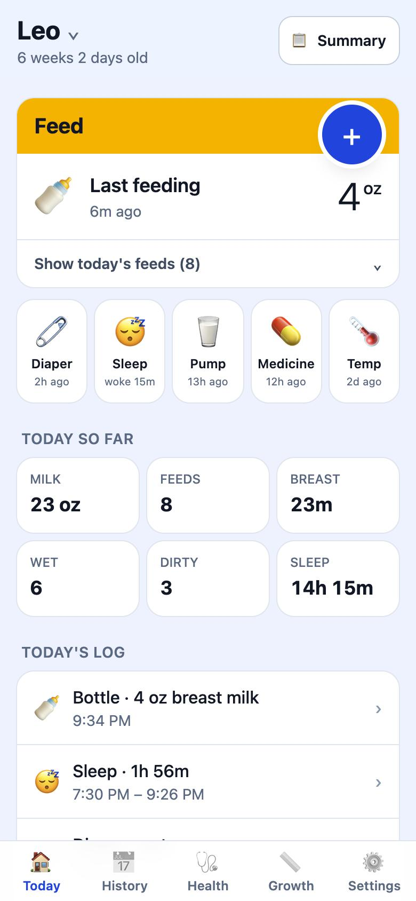
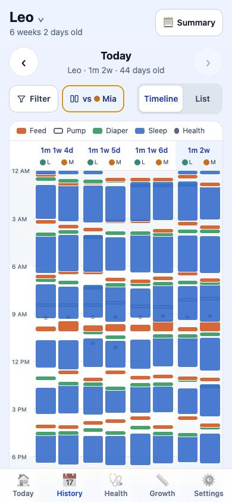
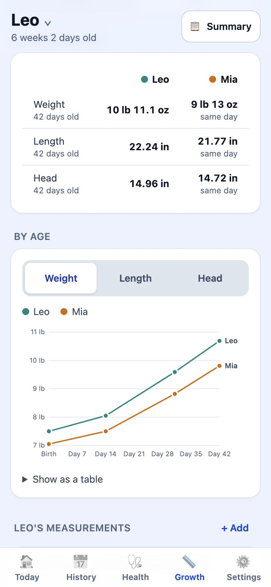
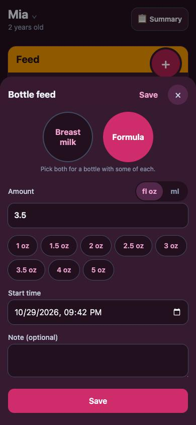

# Sip & Snooze

**A free, real-time baby tracker for families: feeds, diapers, sleep, medicine, growth and doctor visits, shared live between parents and grandparents.**

I built it when the app our family used for our newborn moved to a paid subscription. It's an installable web app (PWA) that two families use every day on their iPhones, and it runs entirely on free tiers, so it costs $0 to host.

**Live:** [sipandsnooze.web.app](https://sipandsnooze.web.app) · **Stack:** React 19, TypeScript, Vite, Tailwind CSS v4, Firebase (Auth, Firestore, Hosting)

<p>
  
  
  
  
</p>

<sub>Screenshots use made-up sample data.</sub>

## Features

- **One-handed logging**: bottle, breastfeeding (a timer per side), solids, pumping, diapers, sleep, medicine and temperature. Most entries take two taps, and **Use last amount** repeats the previous bottle.
- **Live sync**: everyone in a family sees new entries instantly, including who logged them. Entries made offline sync when the phone reconnects.
- **History timeline**: a 4-day timeline (feeds, diapers, sleep) with filters, a list view, and swiping between days.
- **Sibling comparison by age**: shows a newborn's day 20 next to an older sibling's day 20, in History and in Growth.
- **Health records**: doctor visits with follow-ups, vaccines, medicines, and a running list of questions for the pediatrician.
- **Growth tracking**: weight, length and head size, charted by age.
- **CSV import and export**: import works with CSV files from other baby apps, including a full importer for Nara Baby. Re-importing a file never creates duplicates.
- **Units your way**: oz/ml, °F/°C and lb/kg, switchable on each form and saved per phone. Data is always stored in metric.
- **Per-baby color themes**: blue for a boy, pink for a girl, in light and dark mode.
- **Private by design**: families join with an invite code and can never see each other's data.

## Technical highlights

- **Security rules as the backend.** There is no custom server. [`firestore.rules`](firestore.rules) enforces family membership, invite-code joins, and that every entry is signed by its author. An [emulator test suite](rules-test/rules.test.js) checks those rules, including that two families stay separate and that a removed member can't rejoin with the old invite code.
- **A swappable backend interface.** The app talks to a [`Backend`](src/lib/backend.ts) interface with two implementations: [Firebase](src/lib/firebaseBackend.ts) and a [localStorage demo](src/lib/demoBackend.ts). The whole app runs with no account and no network (`npm run dev:demo`), which made UI work and testing fast.
- **Offline-first.** Firestore's persistent local cache plus a service worker (vite-plugin-pwa) mean the app opens and logs entries without a connection.
- **Idempotent CSV import.** [`csvImport.ts`](src/lib/csvImport.ts) detects column layouts and units (including Nara's split formula/breast-milk bottles and fluid-ounce columns). Each imported row gets an ID derived from a hash of its contents, so importing the same file twice overwrites instead of duplicating. This mattered on Firestore's free plan of 20,000 writes per day.
- **Bounded reads.** Only the last week of entries stays subscribed. Older History weeks and a sibling's matching week are loaded on demand for just that date range, which keeps usage well inside the free 50,000 reads per day.
- **Theming with one CSS file.** Tailwind v4 exposes the palette as CSS variables, so the boy/girl themes re-point the accent palette and tint the dark-mode surfaces in [`index.css`](src/index.css) without touching any component.
- **Gestures without a library.** A small [`useSwipe`](src/lib/swipe.ts) hook tells sideways swipes apart from vertical scrolls, follows the finger with resistance at the edges, and ignores touches inside open sheets.

## How I built it

I built Sip & Snooze end to end, from the problem to a production app two families use every day. I used **Claude Code** as my AI development tool throughout: planning features, generating and refactoring code, writing tests, and debugging. I led the work: I defined every feature, made the architecture calls (a PWA on Firebase's free tier, Firestore security rules as the access-control layer, a swappable backend with an offline demo mode), and verified each change against real data before shipping. [More on my process →](docs/HOW-I-BUILT-THIS.md)

## Running it locally

```bash
npm install
npm run dev:demo     # demo mode: data stays in the browser, no Firebase needed
```

| Command | What it does |
|---|---|
| `npm test` | Unit tests: CSV import, unit conversion, age math, growth comparison |
| `npm run test:rules` | Firestore security-rules tests on the emulator (needs Java) |
| `npm run build` | Type-check and production build |
| `npm run deploy` | Build and deploy hosting and rules to Firebase |

To connect your own Firebase project, follow [docs/SETUP.md](docs/SETUP.md).

## Project structure

```
src/
  screens/      Today, History, Health, Growth, Settings, sign-in and setup
  components/   Entry forms, timeline, charts, header, import sheet, UI kit
  lib/          Backend interface + Firebase/demo backends, CSV import/export,
                units and date math, activity categories, swipe gesture
firestore.rules Security rules (the app's access control)
rules-test/     Emulator tests for the rules
```

## Data model

```
families/{familyId}          name, members, invite code
  babies/{babyId}            name, birth date, optional boy/girl theme
    entries/{id}             bottle | breast | solid | pump | diaper | sleep | med | temp
    records/{id}             visit | vaccine | growth | question
invites/{code}               maps an invite code to its family
```
